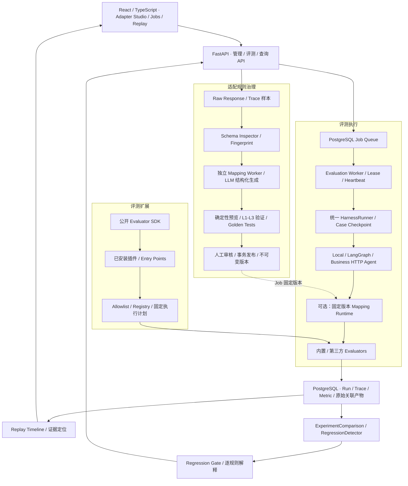

<div align="center">

# EvalForge · Agent Evaluation Harness

**面向 AI Agent 与 RAG 的可扩展评测、执行证据与回归门禁平台**

从异构 Agent 接入，到插件化指标、可恢复实验与版本回归，建立完整的评测工程闭环。


[架构设计](#系统架构) · [核心能力](#六项核心工程能力) · [端到端证据](#真实端到端验证) · [本地运行](docs/GETTING_STARTED.md) · [开发插件](docs/extending-evaluators.md) · [源码导读](#源码导读)

</div>

---

## 项目解决什么问题

Agent 的一次升级，可能同时改变 Prompt、模型、检索策略、工具调用和输出格式。回答更流畅，并不意味着检索更准确、工具更可靠或成本更低。缺少统一评测与执行证据时，版本决策很容易退回到人工试问和主观判断。

**EvalForge 将 Agent 迭代组织成可检查的工程流程：**

```text
接入 Agent → 执行 Dataset → 保存 Trace 与指标 → 对齐 Baseline / Candidate → 回归检测 → 质量门禁
```

项目围绕真实工程中的三个难点展开：

- **接入难：** 用受约束的 Mapping DSL 统一异构 Response / Trace，AI 负责生成候选，正式评测执行固定规则。
- **扩展难：** 将评测能力做成独立 SDK 与第三方插件，新增指标通过安装和服务端授权接入。
- **信任难：** 将任务归属、版本、原始证据、指标语义和 Gate 判定关联起来，让每个结果有解释依据。

| 已实现的工程闭环 | 可直接检查的证据 |
| --- | --- |
| **异构数据 → AI 生成 → 验证 → 人工审核 → 固定版本执行** | [Intelligent Adapter System](docs/INTELLIGENT_ADAPTER_EVALUATION_INTEGRATION.md) |
| **独立插件包 → 真实安装 → Entry Points → API 选择 → 持久化 → Gate** | [第三方插件 E2E](docs/plans/evaluator-plugin-stage6.md) |
| **持久化 Job → 多 Worker 领取 → Lease / Heartbeat → Checkpoint 恢复** | [执行器](backend/app/jobs/executor.py) · [PostgreSQL JobStore](backend/app/jobs/postgres_store.py) |
| **React Studio → 样本分析 → Mapping 预览 → 三层验证 → 审核发布** | [Adapter Studio](docs/INTELLIGENT_ADAPTER_STUDIO.md) |

**最近一次完整 Python 回归：852 项实际执行，851 通过、1 项既有失败、0 跳过。** 包含真实 PostgreSQL、SDK / Registry / Loader 与独立插件测试。[查看范围与已知失败](#测试与验证)

## 系统架构

系统以统一契约为中心，将配置生成、评测执行和结果决策分开组织。



**一个 Runner，三种职责边界：** Adapter 负责调用与标准化，Evaluator 负责指标，Runner 负责生命周期、并发、重试和保存。插件与智能适配都接入现有数据流，比较和门禁共享同一套指标语义。

## 六项核心工程能力

### 1. Intelligent Adapter：把异构接入变成可治理的规则

不同 Agent 将答案放在不同字段，Trace 也可能采用完全不同的事件名和嵌套结构。EvalForge 将接入过程做成独立的配置治理链路：

```text
多个 JSON 样本
  → Schema Inspector：字段路径、类型、频率、nullable、结构差异、稳定指纹
  → Mini Mapping Agent：结构化 MappingSpec、来源证据、不确定性
  → Runtime / Validator：执行预览、结构校验、拓扑校验、独立 Golden
  → 有界修复 / needs_manual_review
  → 人工审核 / 事务发布
  → Evaluation Job 固定已发布版本
```

- **受约束 DSL：** extract、rename、enum_map、cast、coalesce、sum_if_present；严格 Pydantic 模型，可存为 JSONB。
- **确定性执行：** 正式 Case 评测不调用 Mapping Agent，不执行模型生成的 Python；固定输入和规则得到固定映射结果。
- **保留未知：** 字段缺失、显式 null、类型错误与转换失败分别表达；未知 Span、时间和 Token 不补造。
- **控制生成成本：** 明确披露的样本摘要、调用预算、超时、结构化错误反馈与有界修复。
- **版本治理：** Job 固定 adapter_id / version / digest；中途发布新规则不会改变正在执行的任务。

**工程选择：将 AI 的不确定性留在候选生成阶段，将正式执行约束在已验证的声明式规则中。**

[DSL](backend/app/adapters/intelligent/contracts.py) · [Runtime](backend/app/adapters/intelligent/runtime.py) · [Inspector](backend/app/adapters/intelligent/inspector.py) · [发布集成](backend/app/adapters/intelligent/published.py)

### 2. 插件化评测引擎：新增指标可独立打包、安装和发布

评测器实现统一异步 SDK 协议，宿主保留执行、错误处理与持久化控制权。

| 层次 | 已实现能力 |
| --- | --- |
| **公开 SDK** | BaseEvaluator、EvaluatorManifest、EvaluationContext、MetricResult；独立安装，不依赖 FastAPI、数据库或 Runner |
| **静态 Registry** | 按 evaluator_id 查询/创建、内置与第三方注册、协议/API 版本校验、重复 ID 拒绝 |
| **Entry Points Loader** | 标准库安装元数据发现 → EntryPoint.load → 注册；分阶段记录状态与来源包 |
| **服务端授权** | evaluator_id + 来源 distribution + 可选包版本允许列表；请求无法指定任意导入路径或安装命令 |
| **动态执行** | 一个任务选择多个指标；每 Case / 每指标创建新实例，独立超时与异常、取消传播 |
| **计划固定** | Job 保存 Manifest、来源版本、配置 Schema 与规范化配置；Worker / 恢复时复核 |
| **结果兼容** | SDK 结果进入原 RunRecord / Store / 指标查询 / Comparison / Gate |

真实示例包 [evalforge-keyword-coverage](examples/evalforge-keyword-coverage) 只依赖公开 SDK。安装后通过固定入口组发现：

```toml
[project.entry-points."evalforge.evaluators"]
keyword_coverage = "evalforge_keyword_coverage:KeywordCoverageEvaluator"
```

创建任务时显式选择：

```json
{
  "evaluators": [
    {"evaluator_id":"keyword_coverage","config":{},"timeout_seconds":30}
  ]
}
```

**工程选择：插件作者维护评分算法，平台统一维护执行契约、来源证据和发布决策。** 未显式选择插件时，原内置评测流程保持兼容。

[SDK 源码](packages/evaluator-sdk) · [开发者指南](docs/extending-evaluators.md) · [动态执行](backend/app/evaluator/execution.py)

内置与可扩展指标覆盖多个维度，任务按需组合：

| 维度 | 指标与证据 |
| --- | --- |
| 回答与要点 | Keyword Match、独立插件 Keyword Coverage；基于明确参考，保留命中解释 |
| 工具行为 | 工具准确率、效率与参数匹配，检查实际调用轨迹 |
| 效率与成本 | Latency、Token Usage、Cost / PricingCatalog；缺证据不猜测 |
| RAG 检索 | Recall@5、MRR@5；依赖人工参考来源标注 |
| 引用与拒答 | citation_recall、citation_grounding、abstention；采用明确的来源与行为规则 |


### 3. 持久化异步执行：让长评测具备恢复路径

评测任务以 PostgreSQL 作为持久化队列，API 创建任务，独立 Worker 执行。长评测的生命周期由数据库状态承载。

| 机制 | 对应工程问题 |
| --- | --- |
| FOR UPDATE SKIP LOCKED 原子领取 | 多 Worker 并发竞争任务 |
| Lease + 独立 Heartbeat | 长 Case 执行期间维持归属、识别失联 Worker |
| worker_id + attempt_count + 有效租约条件 | 拒绝过期 Worker 写回任务进度 |
| Case Checkpoint | 重启后复用已提交结果，跳过已完成 Case |
| 有界恢复 / 取消传播 | 明确失败、恢复与停止条件 |
| Run 与 Raw 关联产物事务保存 | 规范化结果与原始证据一致落库 |

Job 的 completed 表示 Case 已处理完毕；质量是否达标由 Gate 判断。单个 Worker 一次执行一个 Job，Runner 另有 Case 并发控制。

**工程选择：使用 PostgreSQL 事务统一任务状态与执行所有权，减少队列与业务存储之间的协调成本。** 当前不依赖 Redis / Celery；Checkpoint 也不承诺外部 Agent 副作用 exactly-once。

[Worker](backend/app/worker.py) · [Executor](backend/app/jobs/executor.py) · [JobStore](backend/app/jobs/postgres_store.py)

### 4. 证据优先：从汇总分数追到具体执行

每次执行保留 Case、Run、Attempt、指标与 Trace 的关联。启用智能适配时，原始事件还可通过 raw_pointer 追溯到规范化事件。

- **Replay Timeline：** 读取已保存的执行轨迹，查看模型、工具、重试与错误事件；不重新调用 Agent。
- **Raw / Normalized 关联：** 能检查“原始数据是什么、规则如何解释、评测使用了什么”。
- **故障分类：** Agent execution、Mapping、Evaluation failure 分开表达。
- **错误隔离：** 单个插件失败不丢失其他指标；新动态/发布适配路径使用未知质量，避免将评测故障伪装成低质量回答。
- **计量与质量分离：** value 保留原始测量和单位，score 表示归一化质量；缺失 usage / 定价不伪造成本。

**工程选择：让故障与低质量拥有不同的数据表达，保证后续比较和门禁能够解释结果。**

[RunRecord](backend/app/harness/run_record.py) · [Replay](backend/app/harness/replay.py) · [指标语义](backend/app/harness/metric_semantics.py)

### 5. Regression Gate：把版本比较落实为可执行标准

Baseline / Candidate 复用原 ExperimentComparison、RegressionDetector 和 MetricGateRule。

| 比较要素 | 处理方式 |
| --- | --- |
| **案例身份** | 按稳定 Case ID 对齐，保留缺失集合，拒绝重复身份 |
| **指标身份** | 按 metric_name 匹配，并核对生产者及输出身份 |
| **可比性** | 校验插件计划、版本、配置、单位与声明的统计口径；不一致返回不可比 |
| **方向** | score 始终越高越好；原始 value 使用 Manifest.direction |
| **容忍度** | 支持原单位的绝对变化与相对 Baseline 的比例变化 |
| **证据完整性** | 空对齐、缺失指定指标、部分观测、无效数值和零相对基准不会误判 PASS |
| **输出解释** | 每条 finding 包含 evaluable、actual、threshold、passed 与原因 |

已验证的典型判定：

| 场景 | 允许退化 | 结果 |
| --- | --- | --- |
| 高优指标 0.84 → 0.78 | 最大绝对下降 0.05 | **FAIL** |
| 低优时延 1.2s → 1.5s | 最大增加 0.2s | **FAIL** |
| Baseline 缺少指定指标 | 无充分证据 | **不可评估，阻断通过** |
| 使用不同插件版本或配置 | 不满足可比性 | **HTTP 409** |

**工程选择：先确认可比，再计算退化；未发现退化不等于证据足够。** 原 Gate 继续联合检查逐 Case 回归率与聚合阈值。

[Comparison](backend/app/harness/experiment_comparison_service.py) · [Gate](backend/app/harness/regression_gate_service.py) · [字段语义与测试](docs/plans/evaluator-plugin-stage5.md)

### 6. Adapter Studio：把接入、验证与审核做成操作闭环

React / TypeScript 前端提供可用的规则治理工作台，复用 API Client、TanStack Query 与现有组件。

```text
创建 Profile → 上传样本 → 查看 Schema → 生成候选 → 映射关系
→ Raw / Normalized 预览 → Validation Report → 语义确认 → 审核发布 → 历史版本 / 使用情况
```

发布前的三层验证：

| 层级 | 验证内容 |
| --- | --- |
| **L1 · 结构** | Pydantic 契约、类型、枚举、时间格式、重复 Span ID |
| **L2 · 拓扑** | parent 引用、父子环、明显时间异常；允许合法并发，Partial Trace 输出 warning |
| **L3 · 语义** | 与人工定义 Golden 比较 Span Type、Token、Tool Call 等关键字段；证据不足保留 unverified |

Registry 用事务保护审核与发布，已发布版本不可变。独立 Golden 与人工确认约束语义发布，模型无法自动批准自己的输出。

前端 Bearer 保存在页面内存；reader / editor / publisher 权限由后端校验。失败、修复记录、发布阻断原因都可见。

[Studio 页面](frontend/src/pages/AdapterStudioPage.tsx) · [Validator](backend/app/adapters/intelligent/validator.py) · [Registry Store](backend/app/registry/postgres_store.py) · [操作说明](docs/INTELLIGENT_ADAPTER_STUDIO.md)

## 真实端到端验证

第三方插件使用真实包安装与 Entry Points 发现，覆盖完整业务链：

```text
安装公开 SDK
  → 安装 evalforge-keyword-coverage
  → 读取安装元数据 / EntryPoint.load / 原 Registry
  → GET /evaluators / POST /experiments/run
  → 多 Case 并发 / SDK 评分
  → PostgreSQL result_json / GET /runs/{id}
  → Baseline / Candidate Comparison
  → 原 Regression Gate
```

测试 Dataset 为三个稳定 Case，预期关键词为 ["VPN","MFA"]：

| 证据 | Baseline | Candidate |
| --- | --- | --- |
| 测试 Agent 输出 | VPN MFA | VPN |
| keyword_coverage | 1.0 | 0.5 |
| 有效配对数 | 3 | 3 |
| 平均 score 变化 | — | **−0.5** |
| 最大允许下降 | — | **0.2** |
| Gate 判定 | — | **FAIL** |

Candidate 用例顺序反转后仍按 Case ID 对齐。测试直接查询 PostgreSQL JSONB，并经现有 Run / Comparison / Gate API 验证结果。

额外验证包括：SDK-only 虚拟环境中插件未安装不可发现、安装后评分；该环境不存在后端 app / FastAPI。导入失败、缺依赖、重复入口、重复注册、配置错误、评分异常与超时都有独立测试。

**边界明确：** 这里使用真实 FastAPI ASGI、服务、插件与 PostgreSQL，业务 Agent 为确定性测试响应；没有以 Mock Registry 替代插件发现，也不将此解释为线上模型效果评估。

[完整 E2E 测试](backend/tests/test_keyword_coverage_e2e.py) · [阶段报告](docs/plans/evaluator-plugin-stage6.md)

## 技术栈与项目结构

| 层次 | 技术 |
| --- | --- |
| 后端契约与 API | Python 3.12、FastAPI、Pydantic v2 |
| 数据与任务 | PostgreSQL 16、psycopg 异步连接池、JSONB、显式 SQL 迁移 |
| Agent 接入 | Local / LangGraph / Business HTTP Adapter |
| 智能适配 | 声明式 DSL、Schema Inspector、确定性 Runtime、Golden Validator、独立生成 Worker |
| 评测扩展 | 独立 SDK、Python Entry Points、Registry、服务端 allowlist |
| 前端 | React 19、TypeScript 6、Vite 8、Tailwind 4、TanStack Query |
| 验证 | pytest / pytest-asyncio、真实 PostgreSQL、Node 测试、浏览器交互测试 |

```text
packages/evaluator-sdk/                 # 可独立安装的公开协议 / Registry / Loader
examples/evalforge-keyword-coverage/     # 真正独立的第三方指标包
backend/
├── app/
│   ├── adapters/intelligent/           # DSL / Inspector / Runtime / Validator / 生成
│   ├── evaluator/                      # 内置指标 / SDK 桥 / 目录 / 动态执行 / 比较适配
│   ├── harness/                        # Contracts / Runner / Trace / Store / Experiment / Gate
│   ├── jobs/                           # 持久化任务 / 领取 / 执行 / 恢复
│   ├── registry/                       # Adapter 版本 / 审核 / 发布 / 生成任务
│   ├── api/                            # HTTP 入口
│   └── datasets/                       # CSV / JSON / JSONL 与 Case 归一化
├── migrations/                         # Job / 恢复 / Registry / 固定 Mapping 迁移
└── tests/                              # 单元 / API / 数据库 / 安装与端到端测试
frontend/src/                           # Jobs / Experiments / Replay / Adapter Studio
docs/                                  # 设计、接入、运行与阶段验证记录
```

## 运行与演示

默认 Demo 路径无需模型 API Key。完整平台由 PostgreSQL、API、Evaluation Worker 与前端组成；AI Mapping Generation 使用独立 Worker。

[**本地安装、数据库初始化与启动步骤 →**](docs/GETTING_STARTED.md)

安装公开 SDK 与示例插件：

```bash
python -m pip install ./packages/evaluator-sdk
python -m pip install ./examples/evalforge-keyword-coverage
```

服务端授权插件后，重启 API / Worker：

```bash
export EVALFORGE_EVALUATOR_PLUGINS='{"allowlist":[{"evaluator_id":"keyword_coverage","distribution":"evalforge-keyword-coverage","distribution_version":"0.1.0"}]}'
```

| 演示入口 | 适合展示的工程点 |
| --- | --- |
| /evaluation-jobs/new → 任务详情 | 持久化任务、Worker 进度、取消、Experiment 关联 |
| Experiment → Run → /runs/:runId/timeline | 从汇总指标追到执行证据 |
| /adapter-studio | 异构样本分析、规则预览、验证与人工发布 |
| GET /evaluators / 创建任务 API | 插件目录、显式指标选择与原持久化链路 |
| POST /comparisons/experiments / POST /gates/evaluate | 版本差异与可解释门禁 |
| /comparison · Agent Showcase | 独立业务 Agent 的检索、引用、拒答和故障诊断 |

Agent Showcase 使用独立部署的业务 Agent / Bridge，相关模型与数据不在本仓库中。[部署与诊断案例说明](docs/BUSINESS_AGENT_SHOWCASE.md)

## 测试与验证

最近完整 Python 测试记录：**2026-10-25，852 项，851 passed / 1 failed / 0 skipped，85.33s**。这是一份实际执行结果，不是 CI 状态徽章。

```bash
# 先安装 SDK / 示例包；数据库变量必须指向专用、隔离的测试 PostgreSQL
ADAPTER_REGISTRY_TEST_DSN='专用 Registry 测试连接' TEST_POSTGRES_DSN='专用 agent_harness_test 测试连接' backend/.venv/bin/python -m pytest -q --tb=short backend/tests packages/evaluator-sdk/tests examples/evalforge-keyword-coverage/tests
```

| 验证层次 | 证据 |
| --- | --- |
| DSL / Runtime / Inspector / Validator / 生成服务 | 合法与非法输入、缺失/null、边界限制、确定性、修复与预算终止 |
| PostgreSQL / Worker | 原子领取、租约、过期归属、Checkpoint 恢复、事务与并发发布 |
| SDK / Registry / Loader | 独立协议、实例隔离、版本兼容、真实 Entry Points、来源与重复保护 |
| 插件 E2E | 本阶段新增 **27 项全部通过**：17 项独立插件测试 + 10 项安装/API/数据库测试 |
| Comparison / Gate | Case 对齐、方向、阈值边界、版本/配置/口径、部分缺失与不可比阻断 |
| 前端历史验证 | 14 项单元/API 契约、6 项浏览器交互、生产构建与 lint；范围见 [Studio 记录](docs/INTELLIGENT_ADAPTER_STUDIO.md) |

**已知失败：** test_v11_experiment.py::test_duplicate_case_is_rejected 期望 ExperimentRunConflictError，旧内存 Store 实际抛出 ValueError。该问题保留在报告中，未跳过或包装成全绿。完整命令、数据库隔离方式及警告见 [Stage 6 验证报告](docs/plans/evaluator-plugin-stage6.md)。

## 源码导读

推荐从“契约 → 执行 → 恢复 → 扩展 → 决策”阅读，能快速掌握项目最有工程含量的部分：

1. [Contracts](backend/app/harness/contracts.py) / [SDK Models](packages/evaluator-sdk/src/evalforge_evaluator_sdk/models.py)：输入、证据、指标与未知状态。
2. [HarnessRunner](backend/app/harness/runner.py) / [EvaluatorExecution](backend/app/evaluator/execution.py)：单 Case 生命周期与插件错误边界。
3. [Job Executor](backend/app/jobs/executor.py) / [JobStore](backend/app/jobs/postgres_store.py)：多 Worker 归属、恢复与 Checkpoint。
4. [Plugin Loader](packages/evaluator-sdk/src/evalforge_evaluator_sdk/plugin_loader.py) / [示例包](examples/evalforge-keyword-coverage)：第三方如何独立接入。
5. [Mapping Runtime](backend/app/adapters/intelligent/runtime.py) / [Validator](backend/app/adapters/intelligent/validator.py)：如何约束异构数据与生成结果。
6. [Registry Store](backend/app/registry/postgres_store.py) / [Published Adapter](backend/app/adapters/intelligent/published.py)：审核事务与固定版本执行。
7. [比较适配](backend/app/evaluator/comparison.py) / [Regression Gate](backend/app/harness/regression_gate_service.py)：如何把指标转成可信版本决策。

## 深入文档

| 主题 | 文档 |
| --- | --- |
| 安装、数据库初始化、API / Worker / 前端启动 | [本地运行](docs/GETTING_STARTED.md) |
| 独立 SDK、插件注册、安装、评分与安全 | [第三方开发者指南](docs/extending-evaluators.md) |
| 插件真实安装到 PostgreSQL / Gate | [第三方插件 E2E](docs/plans/evaluator-plugin-stage6.md) |
| 指标方向、版本、配置与比较口径 | [Plugin Regression Gate](docs/plans/evaluator-plugin-stage5.md) |
| 动态指标选择、执行与 Worker 固定计划 | [Dynamic Evaluator Execution](docs/plans/evaluator-plugin-stage4.md) |
| Mapping 数据契约与确定性执行 | [DSL](docs/INTELLIGENT_ADAPTER_MAPPING_DSL.md) · [Runtime](docs/INTELLIGENT_ADAPTER_MAPPING_RUNTIME.md) |
| 多样本结构分析与安全生成 | [Inspector](docs/INTELLIGENT_ADAPTER_SCHEMA_INSPECTOR.md) · [Mini Mapping Agent](docs/INTELLIGENT_ADAPTER_MINI_MAPPING_AGENT.md) |
| 结构、拓扑、语义与 Golden | [Mapping Validator](docs/INTELLIGENT_ADAPTER_MAPPING_VALIDATOR.md) |
| 审核、事务、版本与正式运行集成 | [Registry](docs/INTELLIGENT_ADAPTER_REGISTRY.md) · [Evaluation Integration](docs/INTELLIGENT_ADAPTER_EVALUATION_INTEGRATION.md) |
| 前端与独立业务 Agent | [Adapter Studio](docs/INTELLIGENT_ADAPTER_STUDIO.md) · [Business Agent Showcase](docs/BUSINESS_AGENT_SHOWCASE.md) |

## 工程边界与后续演进

项目已完成具有真实数据库、独立 Worker、插件安装与前端工作台的评测闭环。向生产部署演进时，仍需统一认证与多租户、可复现后端依赖、数据保留策略、容量压测和 CI 门禁集成。

- 第三方插件是受信任的同进程 Python；allowlist 不是沙箱，协作式超时不能强制终止恶意阻塞代码。
- 稳定 Case ID 与版本标签需要配合不可变数据集治理；框架不能自动证明外部模型或资源语义未变化。
- 规则指标和关键词覆盖提供可解释证据，语义正确性仍需独立标注与校准。
- Replay 是执行证据查看；Gate 已有 API，前端 /gate 仍为占位页。

**EvalForge 展示的是一套完整的 AI 评测工程方法：统一接入、受控扩展、可靠执行、证据关联、版本治理与可解释决策。**
