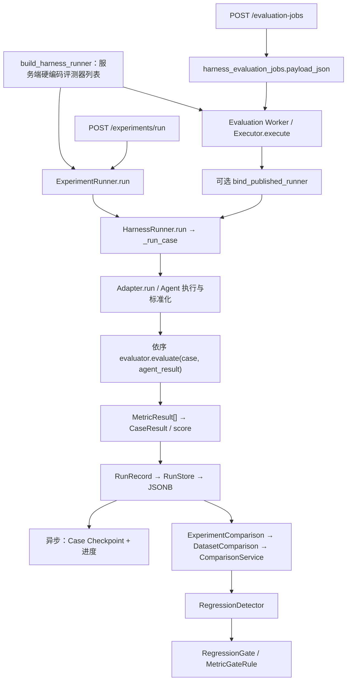
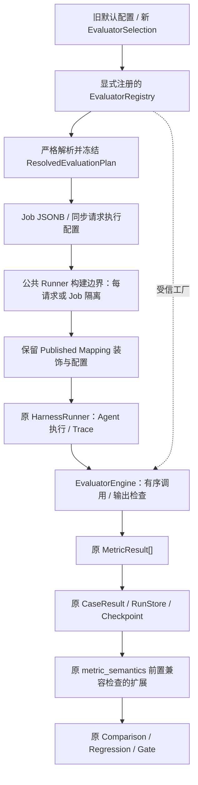

# Evaluator 插件化 Stage 0：架构审计与改造方案

- 审计日期：2026-10-25（Asia/Shanghai）。
- 仓库：`/home/terry/projects/agent-evaluation-harness`；Windows 对应 `\\wsl.localhost\Ubuntu\home\terry\projects\agent-evaluation-harness`。
- 代码基线：`762f967c8cec06203b1d6603417002c4df1aeb09`。
- 本阶段范围：阅读源码、追踪调用、离线行为核验、输出设计；只新增本文，不修改业务实现、迁移、依赖、前端或测试。
- 下文“现状”均有实际源码依据；“建议新增”的文件、类、字段和接口目前不存在，不能当作已实现能力。

## 1. 审计结论

**现有系统已经有可扩展的 Evaluator 抽象和统一的 Case 执行器。插件化应补在评测器的发现、配置解析、实例构建、执行校验和版本证据上，继续输出现有 MetricResult，继续使用现有 Comparison / Regression / Gate 算法。**

已确认的关键事实：

1. `BaseEvaluator.evaluate(case, result) -> MetricResult` 已是异步扩展接口；无需另造 EvaluatorV2 或 PluginMetricResult。[base.py:6–17](../../backend/app/evaluator/base.py#L6-L17)
2. `HarnessRunner._run_case` 是真实指标执行位置：按列表顺序串行 await，每次返回一个指标，再对非 None 的 score 做等权平均。[runner.py:296–342](../../backend/app/harness/runner.py#L296-L342)
3. API 和 Evaluation Worker 都使用 `build_harness_runner`，但列表由服务端 Agent 模式硬编码；不是按 Job 选择指标。[runtime_factory.py:32–70](../../backend/app/runtime_factory.py#L32-L70)、[main.py:132–147](../../backend/app/main.py#L132-L147)、[worker.py:429–435](../../backend/app/worker.py#L429-L435)
4. 当前 Job / 同步请求没有指标选择字段，也没有 Evaluator Catalog HTTP 接口。新增选择参数必须同时贯通 DTO、domain、持久化和 Worker；仅在 Router 增加字段不会生效。实际请求模型见 [evaluation_jobs.py:24–98](../../backend/app/schemas/evaluation_jobs.py#L24-L98)、[experiment_execution.py:110–173](../../backend/app/schemas/experiment_execution.py#L110-L173)。
5. Published Mapping 链路额外使用 `EvidenceAwareEvaluator` 保护证据范围、缺失 Token/费用及工具质量；它和 `bind_published_runner` 都必须纳入改造。[published.py:102–176](../../backend/app/adapters/intelligent/published.py#L102-L176)
6. Comparison 已支持任意指标名，但主要通过 name / unit 判断配对与可比性，并不知道评测器版本、参数和算法语义。同名不等于同义。[comparison_service.py:205–349](../../backend/app/harness/comparison_service.py#L205-L349)
7. 当前错误行为、平均分定义和历史 fallback 都是兼容契约。插件化不能顺便更改这些语义，也不能将 Comparison 或 Gate 改造成新的评分引擎。

本次额外识别四个优先风险：重复指标名被覆盖；新增选择字段可能被旧 Pydantic DTO 静默忽略；评测配置可能沿 context.metadata 泄漏给 Agent；恢复任务目前没有固定 Evaluator 配置证据。详见第 8 节。

## 2. 当前实际执行链路

### 2.1 总体架构



图中的统一点是 `HarnessRunner`，并非 `app/evaluator/runner.py` 中的兼容类。异步 Executor 每次调用 `run([case])`，同步实验可一次提交多个 Case；这会影响实例生命周期与并发设计。

### 2.2 同步实验入口

1. `main.lifespan` 初始化 Run / Experiment / Job Store；`build_harness_runner` 选择 Adapter 与评测器，注入 `ExperimentRunner`。[main.py:89–147](../../backend/app/main.py#L89-L147)
2. `POST /experiments/run` → `api.experiment_execution.run_experiment`，将请求案例转为 `TestCase`，传递实验名称与版本标签。[experiment_execution.py:40–88](../../backend/app/api/experiment_execution.py#L40-L88)
3. `ExperimentRunner.run` 创建 Experiment，调用现有 `harness_runner.run(cases)`；随后绑定结果 Run 并完成实验。取消/异常进入既有失败处理。[experiment_runner.py:72–167](../../backend/app/harness/experiment_runner.py#L72-L167)
4. `ExperimentRunner` 是实验生命周期编排，不能再放一套插件执行循环。

### 2.3 异步 Evaluation Job 入口

1. `POST /evaluation-jobs` → `create_evaluation_job` → `body.to_domain()` → `store.create(payload)`，返回 202 与 Location。仅显式 Mapping 绑定额外要求 Registry editor 身份。[api/evaluation_jobs.py:45–76](../../backend/app/api/evaluation_jobs.py#L45-L76)
2. `EvaluationJobPayload` 目前保存名称、数据集/Agent/模型/Prompt 标签、metadata、cases，以及可选 Adapter 固定版本；没有 Evaluator 选择或版本快照。[jobs/models.py:41–111](../../backend/app/jobs/models.py#L41-L111)
3. `PostgresEvaluationJobStore.create` 将 payload.model_dump(mode="json") 存入 `harness_evaluation_jobs.payload_json`。[jobs/postgres_store.py:119–153](../../backend/app/jobs/postgres_store.py#L119-L153)
4. `worker.run_worker` 创建同一工厂的 Runner，使用现有 claim / Lease / Heartbeat / recover 流程，交给 `EvaluationJobExecutor.execute`。领取 SQL 使用 SKIP LOCKED。[worker.py:352–529](../../backend/app/worker.py#L352-L529)、[jobs/postgres_store.py:262–280](../../backend/app/jobs/postgres_store.py#L262-L280)
5. Executor 验证所有权，先调用 `bind_published_runner`，读取 Case Checkpoint，创建/复用 Experiment，然后对未提交案例调用 `job_runner.run([case])`。[executor.py:420–439](../../backend/app/jobs/executor.py#L420-L439)、[executor.py:548–622](../../backend/app/jobs/executor.py#L548-L622)
6. Runner 先保存 Run；Executor 再用原 fencing 条件原子提交 Case Checkpoint 与进度，并将权威 checkpoint.run_id 关联到 Experiment。两个提交边界之间可能留下孤立 Run，不能声称 exactly-once。
7. `_load_checkpoints` 检查进度、Case 集合和结果计数；已提交案例会跳过。当前 Published Mapping 恢复校验核对 Adapter 绑定，尚未核对 Evaluator Plan。[executor.py:282–351](../../backend/app/jobs/executor.py#L282-L351)、[executor.py:494–505](../../backend/app/jobs/executor.py#L494-L505)

**结论：异步路径已经使用统一评测入口，不需要新增“Plugin Worker”或替换任务队列。缺失的是可恢复的指标配置。**

### 2.4 Runner 内部顺序与失败行为

依据 [HarnessRunner.__init__/run](../../backend/app/harness/runner.py#L58-L218)、[_run_case](../../backend/app/harness/runner.py#L220-L554)：

1. 构造时拒绝空 evaluators 列表；仅类型注解，没有运行时检查唯一 name 或具体继承关系。
2. run 将 dict 解析为 TestCase，用 Semaphore 控制 Case 并发；同一个 Runner 的评测器实例会被多个 Case 共享。
3. 每个 Case 创建 RunContext，发 agent_start，构造 AgentRequest，再运行 Agent 重试与超时逻辑。
4. 合并 Agent Trace，发 agent_end，将完整 Trace 快照及运行身份写回 AgentResult。
5. 将阶段切到 evaluation；按 evaluators 原始顺序串行调用，每个评测器收到同一个 case / agent_result 对象。
6. 收集 MetricResult；仅 score 非 None 的指标参与等权平均。普通路径没有评分指标时 score=0；Published Mapping 路径还检查 quality_score_unverified，没有有效质量分时保留 None。
7. 构建 CaseResult 并持久化，再返回 EvaluationReport。报告中任一 Case score=None 时 average_score=None，否则沿用普通平均；空数据集为 0。
8. 任一 Evaluator 抛异常，后续 Evaluator 不执行。已有局部 metric_results 不会放入失败 CaseResult，最终 metrics 默认为 []。Agent 成功 Trace 仍保留。
9. 未绑定 Mapping 的失败沿用 score=0 / failure_kind=None；已绑定路径为 score=None / failure_kind="evaluation"。不能通过本次插件化默认改成“忽略坏指标继续平均”。
10. ExecutionPolicy.timeout_seconds 仅包住 `_run_agent_with_retry`，不覆盖指标循环。当前没有独立 Evaluator timeout / retry / budget。[runner.py:556–584](../../backend/app/harness/runner.py#L556-L584)

## 3. Evaluator 抽象与内置能力清单

### 3.1 可直接复用的接口

`BaseEvaluator` 只有 name 与 async evaluate(TestCase, AgentResult) -> MetricResult，没有插件 ID、版本、配置 Schema、适用条件、依赖能力或生命周期约定。[base.py:6–17](../../backend/app/evaluator/base.py#L6-L17)

`EvaluationRunner(agent)` 是向后兼容 shim，继承 HarnessRunner，固定 LocalAgentAdapter + KeywordMatchEvaluator。不要把这个历史模块改造成另一套运行引擎，也不要移除旧 import。[evaluator/runner.py:8–15](../../backend/app/evaluator/runner.py#L8-L15)

`evaluator/__init__.py` 的 __all__ 仅导出 BaseEvaluator / KeywordMatchEvaluator，不是 Registry。当前源码扫描未找到 EvaluatorRegistry、插件 entry_points 或 HTTP catalog。已有 Adapter Registry 是 Mapping 治理设施，不能将其当作 Evaluator Registry。

### 3.2 内置评测器

| 实际类/函数 | 输出 name | 输入依赖与当前行为 | 代码位置 |
| --- | --- | --- | --- |
| KeywordMatchEvaluator.evaluate | keyword_match | expected_output 按空格拆词，检查 output_text 子串；空期望给 0；输出 score 与 matched/missing | [keyword.py:5–37](../../backend/app/evaluator/keyword.py#L5-L37) |
| ToolAccuracyEvaluator.evaluate | tool_accuracy | 期望工具/参数，对照最后成功 Attempt 的 tool_call；默认 Exact matcher，可注入 Partial matcher；无期望且无调用给 1 | [tool_accuracy.py:18–140](../../backend/app/evaluator/tool_accuracy.py#L18-L140)、[tool_argument_matcher.py:5–104](../../backend/app/evaluator/tool_argument_matcher.py#L5-L104) |
| ToolEfficiencyEvaluator.evaluate | tool_efficiency | 最后成功 Attempt 的工具签名去重比例；无调用给 1 | [tool_efficiency.py:14–124](../../backend/app/evaluator/tool_efficiency.py#L14-L124) |
| LatencyEvaluator.evaluate | latency | 读取 agent_end.elapsed_ms，fallback 首尾时间差，再 fallback 0；value / ms，没有质量 score | [latency.py:12–77](../../backend/app/evaluator/latency.py#L12-L77) |
| TokenUsageEvaluator.evaluate | token_usage | 累计 model_result.usage；normalize_usage 支持 token 别名并 int 转换/默认 0；原始类扫描传入全部 Trace | [token_usage.py:16–86](../../backend/app/evaluator/token_usage.py#L16-L86)、[usage.py:12–50](../../backend/app/evaluator/usage.py#L12-L50) |
| CostEvaluator.evaluate | cost | 依赖注入 PricingCatalog；按模型价格计算 USD，未知模型跳过并记录；没有质量 score | [cost.py:20–135](../../backend/app/evaluator/cost.py#L20-L135)、[pricing.py:4–33](../../backend/app/evaluator/pricing.py#L4-L33) |
| BusinessRAGEvaluator.evaluate | 下列七种 name | 从 case.metadata.evaluation 读人工标注，从 result.metadata 读 retrieved/citations；根据 name 分支输出，条件不适用时 score=None | [business_rag.py:6–60](../../backend/app/evaluator/business_rag.py#L6-L60) |

Business RAG 七种实际指标为 retrieval_recall_at_5、retrieval_mrr_at_5、citation_recall、citation_grounding、answer_keywords、abstention、tool_contract。构造函数只是赋值 name，名称不受枚举校验；直接构造未知 name 可能得到 N/A，插件 Catalog 必须显式注册白名单。

默认配置：

- HARNESS_AGENT_KIND=demo：keyword_match、tool_accuracy、tool_efficiency，顺序固定。
- HARNESS_AGENT_KIND=business_http：business_evaluators() 返回上述七项，顺序固定。
- Latency / Token / Cost 类已存在，但不在这两个默认工厂列表中，不能在新默认配置里顺手全部启用。
- 独立演示 `langgraph_test_runner.py`、`v10_demo.py` 也直接构造 HarnessRunner；它们不通过运行时工厂，仍需保留直接实例注入方式。

依据：[runtime_factory.py:41–70](../../backend/app/runtime_factory.py#L41-L70)、[business_rag.py:55–60](../../backend/app/evaluator/business_rag.py#L55-L60)、[langgraph_test_runner.py:51](../../backend/app/langgraph_test_runner.py#L51)、[v10_demo.py:34](../../backend/app/v10_demo.py#L34)。

### 3.3 Trace 范围与 Published Mapping 装饰层

- `final_successful_attempt_events` 按 Attempt 边界选最后成功区间；找不到成功区间时返回整个 Trace，不能误写成“一律只读最后成功事件”。[trace_scope.py:6–82](../../backend/app/evaluator/trace_scope.py#L6-L82)
- `EvidenceAwareEvaluator` 对 token_usage / cost / tool_accuracy / tool_efficiency 做范围裁剪；检查 canonical Tool 字段、Token 整数/总和与费用价格证据，不充分时输出 unverified / None。Latency 必须保留 agent_end。[published.py:112–144](../../backend/app/adapters/intelligent/published.py#L112-L144)
- 装饰器通过 name 特判；新插件改名、伪装内置名字或绕过包装均可能改变指标语义。首版必须稳定内置输出名，不允许任意 alias。
- `bind_published_runner` 新建独立 Runner，但目前只复制既有 policy/retry/store/装饰后的 evaluators，并重新设置 execution_metadata。未来新增 engine / plan 字段若不显式传递，会在这里丢失。[published.py:147–176](../../backend/app/adapters/intelligent/published.py#L147-L176)

## 4. 数据模型、持久化与查询

### 4.1 必须复用的数据契约

| 现有模型 | 真实职责与约束 | 插件化建议 |
| --- | --- | --- |
| TestCase | Pydantic；id 可选，输入、期望输出、期望工具、metadata | 保持字段语义；正式 Job 另要求非空且唯一 ID；无需新 Case 模型 |
| AgentResult | Pydantic；output_text、TraceEvent[]、metadata | 插件继续读取它；不引入 PluginAgentResult |
| TraceEvent | 固定 Literal 类型、datetime、payload；时间默认值服务于既有 Harness 生命周期 | 不新增 evaluator_start/end 等类型；运行诊断先放已有 metadata / details |
| RunContext | dataclass；UUID、Case ID、collector、单调时钟、深拷贝 metadata、current_attempt、mapping_artifacts | 首版可保持不变；不是 Evaluator 参数，不直接把它暴露给插件 |
| MetricResult | name、value、unit、score、details；score/value 可 None | 保持唯一指标结果协议，配置模型另建，不另造结果列表层次 |
| CaseResult / EvaluationReport | 案例档案与跨案例平均分，包含现有可空分及故障分类 | 保留原聚合与错误语义 |

依据：[contracts.py:9–111](../../backend/app/harness/contracts.py#L9-L111)、[context.py:13–50](../../backend/app/harness/context.py#L13-L50)。

补充发现：

1. MetricResult 没有 name 非空、重复约束、score 范围、有限数值或 JSON details 约束；它是 Pydantic 模型，但不能据此宣称插件输出已严格验证。
2. TraceCollector.events 只复制列表；事件及 payload 对象仍共享。普通 Runner 的不同 Evaluator 也共享 Case / AgentResult，可被有副作用插件污染。Published 装饰器会深拷贝 result，但不能替代全局插件隔离设计。[trace.py:18–24](../../backend/app/harness/trace.py#L18-L24)、[runner.py:300–314](../../backend/app/harness/runner.py#L300-L314)、[published.py:114](../../backend/app/adapters/intelligent/published.py#L114)
3. 特别注意：`context.metadata` 在 AgentRequest 构造时整体复制。不能将完整插件配置、Judge Prompt、预算、密钥或期望值放入 case.metadata 或 execution_metadata 后假设它只服务于评测。[runner.py:225–267](../../backend/app/harness/runner.py#L225-L267)
4. `app/schema.py` 仅重导出已有 Contracts 并定义 EvaluationRequest；不是另一条在用的指标执行链路。[schema.py:1–25](../../backend/app/schema.py#L1-L23)

### 4.2 指标的实际保存路径

```text
BaseEvaluator.evaluate → MetricResult[]
  → CaseResult.metrics
  → HarnessRunner._persist_run
  → RunRecord.from_execution（复制 Case / Result，推导状态与时间）
  → PostgresRunStore.save
      harness_runs.result_json：完整 CaseResult / metrics / trace
      harness_runs.score：案例总分
      harness_runs.case_json：TestCase
      harness_runs.metadata_json：Run 级元数据
  → PostgresRunStore.get / _row_to_record
  → CaseResult.model_validate
  → MetricResultResponse.from_domain / CaseResultResponse
  → GET /runs/{run_id}
```

源码：[runner.py:775–802](../../backend/app/harness/runner.py#L775-L802)、[run_record.py:49–138](../../backend/app/harness/run_record.py#L49-L138)、[postgres_run_store.py:118–218](../../backend/app/harness/postgres_run_store.py#L118-L218)、[_row_to_record:540–582](../../backend/app/harness/postgres_run_store.py#L540-L582)、[schemas/runs.py:155–284](../../backend/app/schemas/runs.py#L155-L284)。

不存在独立的 SQL metric 表；现有 JSONB 已能容纳每项指标 details 以及 Run 级配置摘要，不应默认新增 metric_results / plugin_runs 表。Run 保存当前为 upsert，不等同于不可变评测档案；本阶段不擅自修改它。

Experiment 只保存版本标签、Run 成员和 metadata；指标比较从成员 Run 重新读取。可复用 Experiment.metadata 存放安全的 Plan 身份，但不能将它当指标明细库。[experiment.py:27–85](../../backend/app/harness/experiment.py#L27-L85)、[experiment_comparison_service.py:125–146](../../backend/app/harness/experiment_comparison_service.py#L125-L146)

Published Mapping 的 Raw 产物仍通过 `save_with_mapping_artifacts` 和 Run 同事务保存；插件改造不能拆开该原子边界。[postgres_run_store.py:583–593](../../backend/app/harness/postgres_run_store.py#L583-L593)

### 4.3 FastAPI 的当前能力与缺口

| 已有接口 | 当前能力 | 缺口 |
| --- | --- | --- |
| POST /evaluation-jobs | 校验案例，持久化排队，支持 Adapter 绑定 | 没有 Evaluator 选择/参数/版本或 Plan 快照 |
| POST /experiments/run | 同步实验，调用同一 Runner | 没有 Evaluator 选择，不能只改异步入口 |
| GET /evaluation-jobs/{id} / progress | 生命周期、版本标签、进度与 Adapter 绑定 | 不返回评测器配置身份 |
| GET /runs / {id} / {id}/timeline | 查询 Run、完整 metrics 与 Trace | 指标没有插件版本证据 |
| POST /comparisons/experiments | 比较已完成实验，默认要求相同 dataset_version | 不核对 Evaluator Plan |
| POST /gates/evaluate | 获取同一 Comparison 后执行既有 Gate | 不应在此重新执行插件 |
| Evaluator Catalog / 指标选择接口 | 当前不存在 | 未来可增加只读 /evaluators，返回受信元数据和参数 Schema |

现状来源：[api/evaluation_jobs.py:51–177](../../backend/app/api/evaluation_jobs.py#L51-L177)、[api/experiment_execution.py:40–88](../../backend/app/api/experiment_execution.py#L40-L88)、[api/runs.py:55–219](../../backend/app/api/runs.py#L55-L219)、[api/comparisons.py:39–72](../../backend/app/api/comparisons.py#L39-L72)、[api/gates.py:49–140](../../backend/app/api/gates.py#L49-L140)。

前端目前也没有选择 Evaluator 的 Job 表单字段；MetricResult 类型支持可空 score，但 CaseResult.score 仍声明为 number，Showcase 有直接 toFixed 调用，后续若扩大可空结果范围需单独对齐，不在本阶段改动。[types/api.ts:150–199](../../frontend/src/types/api.ts#L150-L199)、[BusinessAgentShowcasePage.tsx:63](../../frontend/src/pages/BusinessAgentShowcasePage.tsx#L63)

## 5. Comparison / Regression / Gate：复用范围与可比性缺口

### 5.1 当前实际算法链

1. `ExperimentComparisonService.compare` 加载两个 Experiment，要求状态 completed，按参数检查 dataset_version，然后交给 DatasetComparisonService。[experiment_comparison_service.py:48–147](../../backend/app/harness/experiment_comparison_service.py#L48-L147)
2. `DatasetComparisonService.compare` 加载 Run，先执行 ensure_metric_semantics；按 case.id 唯一索引配对，拒绝无 ID / 重复 ID，统计双方缺失 Case。[dataset_comparison_service.py:64–160](../../backend/app/harness/dataset_comparison_service.py#L64-L160)、[_index_by_case:327–367](../../backend/app/harness/dataset_comparison_service.py#L327-L367)
3. 每对调用 `ComparisonService.compare_records`：overall score 做 candidate-baseline；指标按 name 的并集配对；只有双方 value 存在且 unit 相等时，value_delta 才可比较。[comparison_service.py:108–349](../../backend/app/harness/comparison_service.py#L108-L349)
4. `RegressionDetector.detect` 检查执行状态变化，再根据 RegressionRule 的 overall_score / metric_score / metric_value、方向与阈值生成 finding。缺值给 evaluable=False / regressed=False，不自动替换成零。[regression_detector.py:27–77](../../backend/app/harness/regression_detector.py#L27-L77)、[_evaluate_rule:114–151](../../backend/app/harness/regression_detector.py#L114-L151)
5. lower_is_worse 使用 delta < -threshold；higher_is_worse 使用 delta > threshold；any_change 使用 abs(delta)>threshold。保持现有严格不等式。[regression_detector.py:321–355](../../backend/app/harness/regression_detector.py#L321-L355)
6. Dataset 聚合按指标名分组；score_mean 仅使用双方 score 都存在的配对，value_mean 使用可比较且单位一致的记录，输出覆盖数量。案例回归率为回归案例数 / 已比较案例数。[dataset_comparison_service.py:207–235](../../backend/app/harness/dataset_comparison_service.py#L207-L235)、[_aggregate_metrics:412–641](../../backend/app/harness/dataset_comparison_service.py#L412-L641)
7. `RegressionGate.evaluate` 检查回归率、可选平均分变化、缺失 Case 和 MetricGateRule。规则不可评估时 fail closed。[regression_gate_service.py:30–136](../../backend/app/harness/regression_gate_service.py#L30-L136)
8. MetricGateRule 通过 metric_name 与 target 取聚合值，target 为 score_delta_mean / value_delta_mean / relative_value_delta，operator 为 lte / gte。相对变化分母是 abs(baseline)，baseline=0 时不可评估。[regression_gate.py:18–57](../../backend/app/harness/regression_gate.py#L18-L57)、[regression_gate_service.py:435–519](../../backend/app/harness/regression_gate_service.py#L435-L519)
9. 运行时 Comparison 工厂当前只注册 overall-score-drop 规则：lower_is_worse，阈值 0.03；不能假设每个内置指标都有独立 RegressionRule。[comparison_factory.py:26–70](../../backend/app/comparison_factory.py#L26-L70)

### 5.2 不能重复实现的能力

现有 RunComparison、AggregateMetricComparison、RegressionRule、RegressionDetector、MetricGateRule、RegressionGatePolicy、RegressionGate，以及 HTTP 请求/响应转换应直接复用。

本次设计**不改变**：
- name 配对、Case 匹配、candidate-baseline 差值与均值计算；
- RegressionDirection 的比较方向和阈值公式；
- relative delta 的分母与零基线处理；
- Gate 的 finding 模型、lte/gte、缺指标/缺值 fail-closed 行为；
- 工厂默认回归规则与 Gate 默认阈值。

插件 Descriptor 可以用于参数校验和能力发现，但不能自动改写已配置的规则方向或阈值。

### 5.3 必须在算法之前补充的兼容性检查

现有 `ensure_metric_semantics` 只处理 Published Mapping 的 harness-normalized/v1、混用历史路径和不可用质量；它没有评测插件版本/参数信息。[metric_semantics.py:15–34](../../backend/app/harness/metric_semantics.py#L15-L34)

两个风险：

- 同名插件换参数、算法或价格目录，即使 unit 相同，现有 Comparison 仍可能算出“可比较”的差值。
- 只改变选择的指标集合，也会改变 Case 总分的分母；比较两个总分不再代表同一评测方法。

建议扩展原语义前置检查，或由它调用小型 Plan 兼容检查：新模式比较前核对完整、有序的插件集合、版本、规范化参数摘要、输出定义与聚合策略身份。同名不同义、Plan 缺失或混合新旧证据返回明确不可比较错误（HTTP 可用 409），不进入原计算公式。

第一版以完整 Plan 同义为前提，不做“自动取共同指标重新平均”。当双方都没有新 Plan 时保留历史行为；当只有一方有可验证 Plan 时拒绝新旧混比。需要对比时，以同一 Plan 重跑 Baseline/Candidate，不给历史 Run 补猜版本。

检查应覆盖两个入口：ComparisonService.compare_records 与 DatasetComparisonService.compare（后者在 Case 配对之前检查全部记录），避免仅在 HTTP Router 校验而程序调用绕过。Gate API 复用 ExperimentComparisonService，自然继承检查；纯 `RegressionGate.evaluate(report)` 不拥有原始 Run 证据，仍是现有纯算法。

## 6. 建议的最小插件化架构（全部为未来设计）

### 6.1 目标链路与职责



**最小新增模块：**

| 建议模块 / 类型 | 职责与依赖 |
| --- | --- |
| evaluator/contracts.py：EvaluatorDescriptor、EvaluatorSelection、ResolvedEvaluationPlan | 只定义配置/描述模型；复用现有 MetricResult，不定义新的指标结果 |
| evaluator/registry.py：EvaluatorRegistry | plugin_id/version 到受信 factory + 参数模型 + 输出描述的显式白名单；拒绝重复注册与无法解析的版本；首版是进程内目录，不是数据库管理平台 |
| evaluator/builtin.py：register_builtin_evaluators / 默认 Profile 定义 | 注册已有七类评测器及十三个输出名，封装 Exact/Partial、价格依赖等构造；按现有 demo/business_http 列表保留默认顺序 |
| evaluator/engine.py：EvaluatorEngine | 统一有序调用与新插件输出校验、配置化超时及安全错误转换；输出原 MetricResult[]，首版不做 DAG、并行调度或重新评分 |

公共装配仍由 runtime_factory 完成，不新建第二个 HarnessRunner。Engine 不发 HTTP Agent 请求、不拥有队列、不保存 Run、不调用 Comparison/Gate。映射 Registry 不承担评测插件目录职责。

### 6.2 配置身份与注册规则

建议的配置字段（非当前 API）：

- EvaluatorSelection：plugin_id、显式 version、经过该插件 Pydantic 模型验证的 params。
- EvaluatorDescriptor：plugin_id、version、稳定 metric_name、quality/measurement 类别、期望单位、参数 Schema、所需输入证据、Trace scope 和实例/并发约束。
- ResolvedEvaluationPlan：plan schema 版本、有序解析后的选择、不可变规范化参数、插件实现/语义身份、输出定义、既有等权聚合策略身份、Plan digest，以及诊断用实现 revision。
- Plan digest 使用严格 JSON 的确定性规范化；不包含 run_id、当前时间等执行噪声。实现版本由服务端注册，客户端不能宣称某份代码对应哪个版本。
- Plugin version 与 Adapter version 不同：前者解释如何评分，后者解释如何标准化响应。二者分别记录，不能用 Adapter digest 替代 Evaluator 身份。
- 只允许显式注册的服务端受信代码。不接受请求中的 Python 源码、模块/类导入字符串或任意构造参数；首版不引入 entry_points、插件上传、数据库 Plugin Registry 或执行沙箱。
- 每个实例仍只输出一个 MetricResult；相同 metric_name 不允许在一个 Plan 中出现两次。也不同时选择同一输出的两个版本或两组参数后让 Comparison 覆盖。
- 内置名、默认参数、单位和公式不变。Cost 的 PricingCatalog / matcher 的策略由白名单参数和服务端依赖构造，不能把调用方 dict 直接当任意 kwargs 或动态对象。
- 未知插件、版本不匹配、坏参数、空选择或重复输出在调用 Agent 前失败；不能降级到默认指标后仍声称请求选择已生效。

不建议第一版加入权重、跨指标依赖、批处理评测或 LLM Judge。这些会改变聚合语义、生命周期或费用恢复要求，需后续明确授权与独立版本设计。

### 6.3 Engine 如何接入现有 Runner

只抽取 `_run_case` 的评测器调用与新输出边界到 Engine；Agent 生命周期、重试、Trace 合并、CaseResult 构建、总分聚合和保存仍归原 Runner。迁移时先保持：

1. 依照选择顺序串行调用，保持原单指标返回类型。
2. 使用现有 BaseEvaluator.evaluate(case, result)，不新增必选 context 参数或抽象方法。已有直接注入实例、测试 duck type 和 EvaluationRunner shim 保持可用。
3. 默认严格 fail-fast：某插件异常后不调用剩余插件，不把局部成功指标偷偷平均，不将错误转换为零分 MetricResult。保留 Runner 已有两条错误语义。
4. 新配置路径验证 metric_name 与注册输出一致、唯一性、score 范围、finite 数值、单位及 details 可严格 JSON 序列化。旧持久化模型不全局加紧到无法读历史记录。
5. 对新插件提供输入快照/只读约定，避免修改 Case / AgentResult 污染后续指标；普通旧实例注入不能未经兼容测试就改变所有可观察语义。深拷贝开销与只读约定的取舍需要基准验证。
6. 配置了 Evaluator timeout 才执行其独立超时；旧默认不突然套用新 deadline。Evaluator 失败不能进入 Agent 重试。同步阻塞/不合作协程无法靠 asyncio 提供硬隔离。
7. 先保证每个 Job/同步请求的 Runner 与配置隔离，不给共享 app.state.harness_runner 或 Worker 基础 Runner 就地替换 self.evaluators。内置评测器可视为无跨 Case 状态；第三方有状态插件需 Case 实例隔离或受控串行化，不能默认宣称线程/协程安全。
8. Published Mapping 的装饰必须保留且只应用一次，Latency 保留完整生命周期，Token/Tool 的既有范围与 unknown 规则不变。未来新插件用声明的证据需求扩展，不能只不断增加 name 特判。
9. `bind_published_runner` 克隆新 Runner 时必须传递 Engine / Plan 身份，且不能覆盖掉评测配置；这是必测接入点，不能只改 runtime_factory。

### 6.4 配置持久化、恢复与数据边界

**新 Job：**
- 创建时由服务端公共 resolver 解析默认 Profile 或显式选择，冻结 Plan，再保存 payload_json。
- HTTP 以外的程序化提交也要复用同一 resolver；Store 不能把客户端自行声称的 resolved_plan 当作可信注册结果。未来新配置路径缺少已解析 Plan 必须拒绝，原裸 Store.create 的历史模式单独保留。
- Worker 每次执行尝试按快照实例化，检查本地目录支持的插件版本/实现身份；不重新解析 latest 或随部署改变的默认列表。
- 插件在 Worker 不可用时，作为任务配置失败处理，不调用 Agent，也不生成虚假质量分。
- 恢复时核对已提交 Run 的 Plan digest 与 Job 快照，再复用 Checkpoint。不能将旧配置前半段和新配置后半段拼成同一实验。

**同步请求：**
- 使用同一 resolver / 注册目录 / Engine，构造请求隔离的 Runner。
- 将安全的 Plan 身份关联到 Experiment 和 Run，不能只在异步 Job 中实现插件化。

**模型和存储选择：**
- 新增选择与 Plan 配置模型，复用 EvaluationJobPayload 的 JSONB 和现有 Experiment / Run metadata，不先建新表。
- MetricResult 保持当前字段；可在 details 的专用命名空间保留 plugin_id/version/config_digest 等诊断，但不能覆盖现有 status / quality_score_unverified。
- Run 级安全身份是完整 Plan 的权威关联，不能只给每个 Metric 加版本而丢失选择集合、顺序和总分策略。
- 完整配置只包含严格允许持久化的非敏感参数；密钥、Judge Prompt、客户端实例等不写公开 Run/Experiment metadata。未来若需要敏感参数，必须单独设计受保护配置引用。
- 服务端 Plan 放在 Runner 专用配置字段，或新增服务端专用上下文，不直接塞进当前 context.metadata；到 _persist_run 时再合并安全摘要。Case.metadata / execution_metadata 目前都会进入 AgentRequest。
- 服务端写入的保留键必须压过或拒绝用户伪造值；不能靠客户端 metadata.evaluation_plan 证明配置身份。

**数据库不可变性：**
- v015 已禁止绑定 Mapping Job 的整个 payload_json 被修改，Worker 不能在执行时给这些旧 payload“补 Plan”。
- 若要求所有新 Job 的 Plan 在数据库层不可更改，应在后续独立迁移中仅新增 Plan 保护，保持现有 Mapping 保护，不需重建任务表。推荐候选名称见文件表。
- 当前 RunStore 为 upsert。历史 Run 不得通过重评分覆盖；真正重评应生成新 Run/Experiment。若要数据库级不可变 Run，需要另行评审，不夹带进插件化首版。

依据：[v015:11–37](../../backend/migrations/v015_pinned_mapping_evaluation.sql#L11-L37)、[jobs/postgres_store.py:119–153](../../backend/app/jobs/postgres_store.py#L119-L153)、[executor.py:249–255](../../backend/app/jobs/executor.py#L249-L255)、[runner.py:256–267](../../backend/app/harness/runner.py#L256-L267)。

## 7. 具体文件建议与新旧兼容策略

### 7.1 文件修改清单

下表路径均相对于本文开头的真实仓库根。标记“新增建议”的文件目前不存在；本 Stage 0 不创建它们。

| 状态 | 路径 | 最小职责与边界 |
| --- | --- | --- |
| 新增建议 | backend/app/evaluator/contracts.py | Descriptor / Selection / ResolvedPlan 配置模型 |
| 新增建议 | backend/app/evaluator/registry.py | 显式注册、参数校验、版本解析和受信实例工厂 |
| 新增建议 | backend/app/evaluator/builtin.py | 用现有类注册内置插件与原默认 Profile，不复制算法 |
| 新增建议 | backend/app/evaluator/engine.py | 原调用循环的执行边界和严格新输出检查 |
| 必改 | backend/app/runtime_factory.py | 公共解析/装配函数，保留旧 build_harness_runner(run_store=...) 用法 |
| 必改 | backend/app/harness/runner.py | Engine 委派、Plan 安全持久化；保持原 Case 聚合/失败/保存 |
| 必改 | backend/app/adapters/intelligent/published.py | 克隆保留 Engine/Plan；继续应用 EvidenceAwareEvaluator |
| 必改 | backend/app/schemas/evaluation_jobs.py | 可选选择字段、to_domain 贯通、安全响应摘要 |
| 必改 | backend/app/jobs/models.py | 可向后读取的 frozen Plan 字段；不新增 Job 状态机 |
| 必改 | backend/app/api/evaluation_jobs.py | 排队前解析，未知选择明确 422；不在 HTTP 执行指标 |
| 优先复用，条件修改 | backend/app/jobs/postgres_store.py | 原 JSONB 序列化会随 domain 新字段保存；仅在新的提交校验无法由 resolver/domain 覆盖时补窄校验，不重写领取、Lease 与进度 SQL |
| 必改 | backend/app/jobs/executor.py | 每 Job 装配与恢复 Plan 核验，合并安全 Experiment 身份 |
| 必改 | backend/app/schemas/experiment_execution.py | 同步请求同一选择契约 |
| 必改 | backend/app/api/experiment_execution.py | 同步入口贯通，使用请求隔离的配置 |
| 优先复用，条件修改 | backend/app/harness/experiment_runner.py | 优先在 API 中组合局部 ExperimentRunner 与既有 ExperimentService；只有需新增传参时再扩签名，原实验流程不变 |
| 发现接口阶段修改 | backend/app/main.py | 原工厂可承载注册装配；新增 Catalog Router 时接入，保留原服务生命周期 |
| 优先复用，条件修改 | backend/app/worker.py | 原公共工厂与 Executor 可承载新能力；仅依赖注入确需改变时小改启动装配，Heartbeat/执行循环不重写 |
| 小改前置条件 | backend/app/harness/metric_semantics.py | 调用新 Plan 同义检查，保留现有 Published Mapping 条件 |
| 条件修改 | backend/app/harness/comparison_service.py、dataset_comparison_service.py | 仅当原语义检查入口不能承载时补前置调用；差值/配对/聚合代码不改 |
| 条件修改 | backend/app/api/errors.py | 新配置错误/不可比错误的既有 envelope 映射，不暴露敏感异常 |
| 后续新增建议 | backend/app/api/evaluators.py | 只读目录与参数 Schema；不提供代码上传/动态导入 |
| 条件修改 | backend/app/api/dependencies.py | 给 Catalog / resolver 增加依赖获取 |
| 条件修改 | backend/app/schemas/runs.py | 仅在新增顶层安全摘要确有必要时扩展；details/metadata 已足够则不改 |
| 后续迁移建议 | backend/migrations/v016_evaluator_plan.sql | 仅当落实所有新 Job Plan 的 DB 不可变要求；文件名待阶段确认 |
| 后续前端 | frontend/src/types/evaluationJobs.ts、utils/evaluationJobForm.ts、pages/CreateEvaluationJobPage.tsx | 选择配置与能力发现，旧表单仍可提交默认模式 |
| 条件前端 | frontend/src/types/api.ts、pages/BusinessAgentShowcasePage.tsx | 对齐已有可空 score；不夹带界面重构 |
| 新增测试建议 | backend/tests/test_evaluator_registry.py、test_evaluator_engine.py、test_evaluator_selection.py | 注册/输出/兼容与配置传递 |
| 新增集成测试建议 | backend/tests/test_evaluator_plan_integration.py | 同步/异步一致性、Checkpoint、版本固定、Mapping 装饰及比较前置检查 |

**直接复用、默认不改：**
- evaluator/base.py 及各内置计算类、参数 matcher、usage/pricing、trace_scope；
- harness/contracts.py、context.py、trace.py、run_record.py、run_store.py、memory_run_store.py、postgres_run_store.py 的现有结果与持久化协议；
- harness/comparison.py、experiment_comparison.py、dataset_comparison.py、regression.py、regression_detector.py、regression_gate.py、regression_gate_service.py、comparison_factory.py；
- jobs/state_machine.py、已有 claim / heartbeat / checkpoint / recovery SQL；
- 原 Adapter HTTP 协议、Mapping DSL/Runtime/Validator/Registry，以及 Replay 计算。

“复用不改”不表示免测试；若后续需求证明确需改变，先单独报告兼容影响，不在初版默默扩范围。

### 7.2 兼容矩阵

| 入口/数据 | 建议行为 |
| --- | --- |
| 现有 HarnessRunner(adapter, evaluators=[...]) | 保留；实例注入、旧 duck type 和旧默认错误语义继续可用 |
| EvaluationRunner(agent) 历史 shim | 维持原 Local + Keyword 默认，不要求用户先注册插件 |
| 请求没有新选择字段 / 为约定的 null | 保持当前 Agent 模式默认 3/7 项及顺序；新创建任务可同时冻结默认 Plan |
| 显式选择 [] | 返回错误；Runner 已要求至少一个指标，不能解释为“成功但不评测” |
| 新请求选择未知 ID/版本/坏参数/重复输出 | 在 Agent 调用前明确失败，不 fallback、不忽略 |
| 已持久化且无 Plan 的 Run/Experiment | 原样读取、原指标与总分保留；标记未记录身份，不推断过去版本 |
| 双方都是 legacy 且无 Plan 的比较 | 沿用历史行为，不伪造新证明 |
| 一方新 Plan、一方 legacy，或 Plan 不同 | 新前置检查拒绝；在同一 Plan 下重跑 |
| 部署时旧排队/执行中 Job 没有 Plan | 保留独立 legacy 路径；优先排空旧 Job 再切换，不修改冻结 payload；无法证明前后指标一致时不能宣传可复现 |
| 新 Plan Job 恢复 | 精确版本可用才执行，已提交 Run digest 必须一致；禁止转成当前默认 |
| Plugin version 下线 | 不允许静默换到新版本；明确配置失败或保留所需受信实现 |
| Published Mapping Job | Adapter 固定绑定与指标证据规则继续生效；新增 Plan 不能覆盖或绕过原逻辑 |
| 旧前端对新 API | 不传字段仍可运行默认配置 |
| 新前端对旧 API | 必须先检测 Catalog/协议能力；旧 DTO 可能忽略字段，不能直接提交并假设已选择 |

关键边界：旧 Job 没有保存 Evaluator 身份，无法凭当前代码逆推出创建时配置。支持读取旧数据不等于已经保证旧任务跨部署恢复时配置不漂移；必须记录该限制并安排部署窗口。

## 8. 风险清单与处理优先级

| 级别 | 实际风险 / 证据 | 建议处理 |
| --- | --- | --- |
| P0 | 重复 metric.name：ComparisonService._metric_map 的 dict 推导会以后项覆盖前项（502–517） | Registry 禁止输出名碰撞，Engine 二次检查实际结果；不改变 Comparison 配对算法 |
| P0 | 未知选择字段可能被旧 DTO 静默忽略；当前离线探针已复现 | 新嵌套选择模型严格校验；显式贯通字段；新客户端检测能力；不直接全局 extra=forbid 破坏旧请求 |
| P0 | context.metadata 整体进入 AgentRequest（runner 256–267） | 配置保留在服务端 Runner/Plan 字段，保存时才写安全摘要，不泄漏评测 Prompt/参考答案/密钥 |
| P0 | Published Runner 克隆只复制原字段（published 170–175） | 同时修复克隆配置传递；测试证据装饰一次且不丢 Plan |
| P0 | 恢复时评测器由当前 Worker 工厂决定，没有 Plan 固定证据 | 新任务在创建时冻结、恢复时核验；旧任务不得伪造历史身份，安排部署排空 |
| P0 | 同名不同版本/参数仍可被 name/unit 配对 | 扩展已有语义前置检查，不改变差值/回归/Gate 公式 |
| P1 | 任何 Evaluator 异常终止 Case，丢弃之前局部指标（runner 379–546） | 首版保留 fail-fast；若将来要部分成功，必须单独评审总分/Checkpoint/Gate 语义 |
| P1 | MetricResult 允许越界 score、NaN、非严格 JSON details | 新插件边界严格验证并安全失败，不全局收紧历史读取模型 |
| P1 | Case 并发共享评测器；每指标共享可变输入 | 请求/Job 隔离 + 明确实例 scope；新插件快照/只读约定与资源隔离测试 |
| P1 | Runner 正常保存位于同一 try 内（371–379），存储异常也可能进入 evaluation 分支并再次保存（548–552） | Engine 只转换插件调用错误，不捕获/伪装 Store 异常；现有存储异常边界另记债务，不夹带重构 |
| P1 | Agent timeout 不包含 Evaluator 循环 | 明确独立超时；不承诺 asyncio 能杀死阻塞插件；首版不接付费/不可信外部插件 |
| P1 | 原 Token/Cost 的缺省 0 与 Published unknown=None 语义不同 | 保留模式差异与装饰层，不全局统一 normalize_usage 的默认值 |
| P1 | Regression 不可评估项不计回归，而 Gate 的指定缺指标规则会失败 | 保留两层语义；重要指标需明确配置 MetricGateRule，不能将“未检测回归”说成“已验证通过” |
| P1 | 选择集合改变总分分母；部分指标 N/A，计量指标无 score | Plan 包含原聚合策略；不自动加权或归一化计量值；纯计量 Plan 的质量/Gate 行为需后续明确验收，不宣称总分有质量意义 |
| P1 | 旧 CaseResult.score 前端类型非空、Showcase 直接 toFixed | 在前端支持新模式前单独对齐空值，保留 N/A，不将 None 格式化为 0 |
| P1 | Run 保存与 Checkpoint 是两次提交，外部调用可能重做 | 复用现有恢复与 fencing；Plan 只能固定方法，不能提供外部调用 exactly-once |
| P2 | Executor 注释已承认 Experiment create-before-attach 崩溃窗口（210–227） | 记录为已有可靠性债务，不在插件化夹带大规模修复 |
| P2 | 将插件注册/参数作为开放远程代码入口 | 首版只开放服务端白名单和安全配置，不做插件上传或任意 import |
| P2 | 目录版本标签未必证明实现未变 | 登记明确语义版本与实现 revision；部署时保留所需版本；不能仅换标签就声称可复现 |
| P2 | 已有测试失败与数据库环境依赖 | 将基线问题与本次回归区分，不通过跳过或改算法制造“全绿” |

上述 P0/P1 不是本阶段新增缺陷，主要是现有可扩展接口在变为用户可配置插件后会放大的风险。第一版应先限制受信插件与配置范围，避免同时引入动态执行、复杂调度、LLM Judge 和新结果模型。

## 9. 建议后续阶段与验收边界

以下仅为依赖计划，每一阶段须再获得明确开发指令；本阶段不执行。

### Stage 1：配置契约与受信目录

新增 evaluator/contracts.py、registry.py、builtin.py 及纯单元测试；注册现有插件与默认 Profile。

验收：重复 ID/输出名/版本、未知选择、非法参数拒绝；默认 demo/business 列表与顺序一致；参数 JSON 往返；不要求 Runner/API/DB 先改变。

### Stage 2：执行边界与 Runner 兼容

新增 Engine，受控抽取原循环；保留实例注入和兼容 shim。同步验证 Published 装饰器与 Runner 克隆对 Engine/Plan 的传递。

验收：原指标数值/顺序/均值、N/A、无 score fallback、错误 fail-fast、Agent Trace、重试范围不变；新边界拒绝错名/越界/NaN/不可序列化输出；无状态实例隔离和可配置超时测试。

### Stage 3：冻结配置与同步/异步闭环

贯通创建 DTO/domain/JSONB、公共 resolver、同步请求 Runner、Worker 重建及 Checkpoint 核验；必要时补 Plan 不可变迁移。与此同时完成原 metric_semantics 的新 Plan 前置兼容检查。

验收：两个入口同一选择得到一致方法身份；创建后修改默认目录不影响已排队任务；恢复时缺版本/错 digest 明确失败；已提交 Case 不重跑；新旧比较与不同 Plan 拒绝；相同 Plan 的 Comparison/Gate 数值结果与原算法一致。该完整链路通过前，不向外宣称已支持请求级选择。

### Stage 4：只读发现与使用体验

按需要增加 /evaluators 只读能力发现、前端选项、安全 Plan 摘要和最小端到端测试。

验收：新前端不对旧 API 默默提交无效选择；旧客户端仍可默认评测；没有敏感配置进入 AgentRequest/公开结果；错误与 N/A 有明确展示。数据库插件上传平台、可视化依赖 DAG、LLM Judge 或部分成功策略均需另行授权。

## 10. 本次核验与测试实际结果

### 10.1 源码与行为核验

- 在全库 app Python 源码中搜索 HarnessRunner / EvaluationRunner / evaluate 调用，核对同步、异步、Published 包装及独立演示入口。
- 核对当前 create_app().openapi()：存在 Job / Run / Experiment / Comparison / Gate，没有 Evaluator Catalog 路由。未进入 lifespan，不连接数据库。
- 使用当前真实 Pydantic 模型、ComparisonService 和无模型 DemoAgent 做内存探针，没有新增测试源码或业务修改：

| 探针 | 实际观察 |
| --- | --- |
| CreateEvaluationJobRequest 传入 evaluators=[unknown] | 字段被忽略，model_dump 不包含 evaluators |
| MetricResult(name="probe", score=2) | 接受 2.0 |
| MetricResult(score=NaN) | 接受，isnan 为 True |
| ComparisonService._metric_map 接收同名 1 和 0 | 最终值为后项 0 |
| 三个评测器 good、bad、never，bad 抛异常 | 仅调用 good/bad；最终 metrics=[]、legacy score=0、failure_kind=None；agent_end 仍存在 |

这些是现状验证，不代表已新增保护或修复。新插件边界应优先覆盖这些用例。

### 10.2 本次实际测试命令

从仓库根目录运行，使用现有 Python 3.12 虚拟环境、无数据库与在线模型：

```bash
backend/.venv/bin/python -m pytest -q --tb=short \
  backend/tests/test_run_context.py \
  backend/tests/test_retry_policy.py \
  backend/tests/test_retry_decider.py \
  backend/tests/test_v09_retry.py \
  backend/tests/test_v10_persistence.py \
  backend/tests/test_replay.py \
  backend/tests/test_replay_timeline.py \
  backend/tests/test_v11_comparison.py \
  backend/tests/test_v11_dataset_comparison.py \
  backend/tests/test_v11_experiment_comparison.py \
  backend/tests/test_v11_experiment_runner.py \
  backend/tests/test_v11_regression.py \
  backend/tests/test_v11_regression_gate.py \
  backend/tests/test_v12_openapi.py \
  backend/tests/test_v12_error_contract.py \
  backend/tests/test_v13_jobs_api.py \
  backend/tests/test_v13_jobs_contract.py \
  backend/tests/test_v11_experiment.py
```

实际结果：**56 passed，1 failed，3 warnings，1.79s**。

失败：`test_v11_experiment.py::test_duplicate_case_is_rejected`，测试期望 ExperimentRunConflictError，实际 `InMemoryExperimentStore.attach_run` 抛 ValueError。位置：[测试 327–338](../../backend/tests/test_v11_experiment.py#L327-L338)、[实现 167–175](../../backend/app/harness/memory_experiment_store.py#L167-L175)。本次未改此处，不能报告全绿。

三条 warning 来自 Pydantic TestCase 被 pytest 尝试收集，分别位于 v09_retry / replay_timeline / v13_jobs_contract 测试。

本阶段未启动数据库或其他服务，未调用真实 Agent / 在线 LLM，未运行前端构建、真实 PostgreSQL/恢复故障注入或全项目全量。已有 Published Mapping 集成测试已逐项阅读相关覆盖，但本阶段未重跑依赖专用数据库的测试，不能将旧 70 项通过结果说成本次实测。

### 10.3 后续必须补充的测试矩阵

| 范围 | 验收重点 |
| --- | --- |
| Registry/参数契约 | 默认 Profile、13 个现有输出名、版本/参数校验、重复名与错误输出契约 |
| Engine/兼容 | 顺序、fail-fast、N/A、总分等价、实例注入、无隐式计量评分、输入污染隔离 |
| Trace 证据 | Agent 全生命周期、最后成功 Attempt fallback、Latency 不丢 agent_end、Token/Cost unknown |
| 请求贯通 | 同步与异步、旧 body、新 body、误拼字段的能力检测、未知插件调用 Agent 前失败 |
| PostgreSQL | 选择快照 JSONB 往返、冻结约束、Run 安全摘要、恢复版本一致、原产物事务不变 |
| Comparison/Gate | 任意合法指标沿用原算法；同义 Plan 等价；不同 Plan/新旧混合拒绝；缺指标仍 fail closed |
| Worker | 两 Job 配置互不污染、不同进程目录不一致、Checkpoint 版本错配、取消/Lease/fencing 保持原行为 |
| 安全 | 不执行请求代码、不动态 import、无敏感配置进入 AgentRequest/公开 metadata、错误信息不带密钥 |

优先复用当前 test_run_context、test_v09_retry、test_v10_persistence、test_v11_*comparison / regression*、test_v13_jobs_*、test_published_mapping_evaluation 和 test_business_agent_integration。原测试之外新增明确的插件契约/执行/贯通用例，不重复复制整个 Harness。

## 11. 推荐审查顺序与本阶段产物

1. 先看第 2 节调用链，再读原 `runtime_factory.py`、`harness/runner.py` 和 `evaluator/base.py`。
2. 再看 `adapters/intelligent/published.py`，理解现有证据保护为什么不可跳过。
3. 看原 `contracts.py` → `run_record.py` → `postgres_run_store.py`，确认 MetricResult 能直接复用。
4. 看 Comparison / DatasetComparison 的名称与单位配对，再看 RegressionDetector / RegressionGate 的已有算法。
5. 最后审查第 6～9 节的最小边界、兼容矩阵、文件清单和阶段验收。

本阶段唯一新增文件：`docs/plans/evaluator-plugin-stage0.md`。没有新建 Engine、Registry、API、数据库表或执行任何重构；没有自动提交或推送。审计完成后停止，等待 Stage 1 明确指令。
